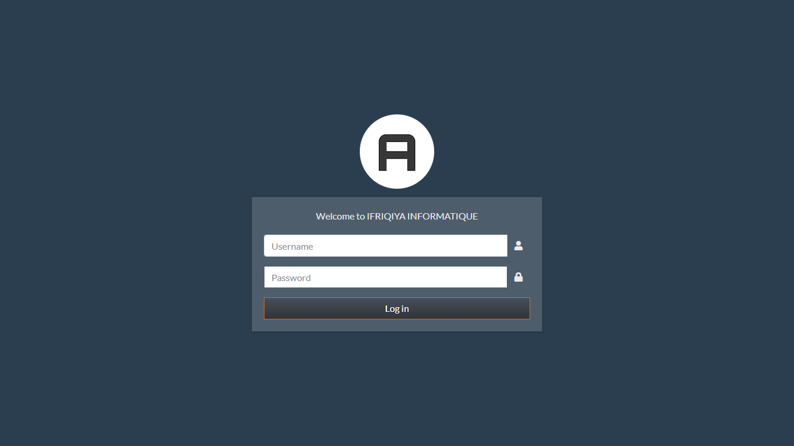

# Django React LMS — Backend Setup


Socle backend Django d'une plateforme **LMS (Learning Management System)** destinée à être couplée à un frontend React. Ce dépôt met en place une base propre et prête à l'emploi :

- 🧱 Structure du projet avec des **applications personnalisées** (`core`, `userauths`, `api`)
- 🎨 **Interface d'administration Django personnalisée** avec [Jazzmin](https://github.com/farridav/django-jazzmin) (thème, couleurs, branding)
- 📁 Configuration des fichiers **static**, **media** et **templates**
- 📦 Stack prévue pour la suite : Django REST Framework, JWT, CORS, Swagger (drf-yasg), Stripe, S3

🎥 **Vidéo de démonstration :** [Voir la démo sur LinkedIn](https://lnkd.in/p/d_q_87Bh)
📂 **Dépôt GitHub :** [wajabri00/Django-Setup-Project](https://github.com/wajabri00/Django-Setup-Project)

---

## 📸 Aperçu



*Page de connexion de l'administration, personnalisée avec Jazzmin.*

---

## 🗂️ Structure du projet

```
.
├── README.md
├── docs/screenshots/              # Captures d'écran du README
└── LMS/Django React LMS/backend/  # Projet Django
    ├── manage.py
    ├── requirements.txt
    ├── backend/                   # Configuration (settings, urls, wsgi, asgi)
    ├── core/                      # Application principale
    ├── userauths/                 # Utilisateurs & authentification
    ├── api/                       # API REST
    ├── static/                    # Fichiers statiques sources
    ├── templates/                 # Templates HTML
    └── media/                     # Fichiers uploadés (créé à l'exécution)
```

---

## 🚀 Installation

> ⚠️ Le chemin contient des espaces : pensez à le mettre **entre guillemets**.

### 1. Cloner le dépôt et se placer dans le dossier backend

```bash
git clone https://github.com/wajabri00/Django-Setup-Project.git
cd Django-Setup-Project
cd "LMS/Django React LMS/backend"
```

### 2. Créer l'environnement virtuel `.venv`

```bash
python -m venv .venv
```

### 3. Activer le `.venv`

| Terminal | Commande |
|---|---|
| **PowerShell** (Windows) | `.\.venv\Scripts\Activate.ps1` |
| **CMD** (Windows) | `.venv\Scripts\activate.bat` |
| **Git Bash** (Windows) | `source .venv/Scripts/activate` |
| **macOS / Linux** | `source .venv/bin/activate` |

Une fois activé, le préfixe `(.venv)` apparaît dans le terminal. Pour le désactiver : `deactivate`.

<details>
<summary>❗ PowerShell : « l'exécution de scripts est désactivée sur ce système »</summary>

Autorisez les scripts locaux pour votre utilisateur (une seule fois) :

```powershell
Set-ExecutionPolicy -Scope CurrentUser -ExecutionPolicy RemoteSigned
```

Ou, sans activer le venv, appelez directement son interpréteur :

```powershell
.\.venv\Scripts\python.exe manage.py runserver
```
</details>

<details>
<summary>💡 VS Code</summary>

Le fichier `.vscode/settings.json` pointe déjà vers `LMS/Django React LMS/backend/.venv`. Ouvrez la racine du dépôt dans VS Code : l'interpréteur est sélectionné et chaque nouveau terminal active le `.venv` automatiquement.
Sinon : `Ctrl+Shift+P` → **Python: Select Interpreter** → choisissez `.venv`.
</details>

### 4. Installer les dépendances

```bash
python -m pip install --upgrade pip
pip install -r requirements.txt
```

<details>
<summary>❗ Erreur « Microsoft Visual C++ 14.0 or greater is required » (PyYAML)</summary>

Sur une version récente de Python pour laquelle PyYAML ne publie pas encore de wheel, installez-le sans extension C, puis relancez l'installation :

```powershell
$env:PYYAML_FORCE_LIBYAML = "0"; pip install PyYAML
pip install -r requirements.txt
```

Alternative : utiliser Python 3.11 ou 3.12.
</details>

### 5. Appliquer les migrations et créer un administrateur

```bash
python manage.py migrate
python manage.py createsuperuser
```

### 6. Lancer le serveur

```bash
python manage.py runserver
```

Administration : **http://127.0.0.1:8000/admin/**

---

## ⚙️ Configuration

| Paramètre | Valeur |
|---|---|
| `TEMPLATES.DIRS` | `backend/templates/` |
| `STATICFILES_DIRS` | `backend/static/` |
| `STATIC_ROOT` (`collectstatic`) | `backend/staticfiles/` |
| `MEDIA_ROOT` / `MEDIA_URL` | `backend/media/` → `/media/` |
| Base de données | SQLite (`db.sqlite3`) |

La personnalisation de l'administration (titre, logo, couleurs, thème `slate`) se trouve dans `JAZZMIN_SETTINGS` et `JAZZMIN_UI_TWEAKS` à la fin de `backend/settings.py`.

---

## 🧪 Tests

```bash
python manage.py test                 # tous les tests
python manage.py test api             # une application
```

---

## 🛣️ Feuille de route

- [ ] Modèle utilisateur personnalisé dans `userauths`
- [ ] API REST avec Django REST Framework + authentification JWT
- [ ] Documentation Swagger (drf-yasg)
- [ ] Frontend React
- [ ] Variables d'environnement (`.env`) pour `SECRET_KEY`, `DEBUG` et la base de données

---

## 🛠️ Technologies

Django 4.2 · Django REST Framework · SimpleJWT · Jazzmin · drf-yasg · django-cors-headers · django-storages (S3) · Stripe · SQLite / PostgreSQL
